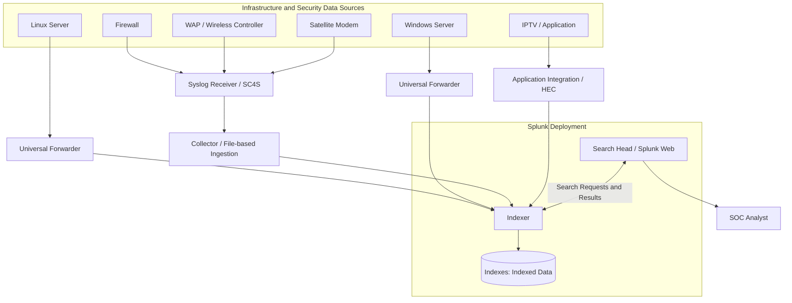
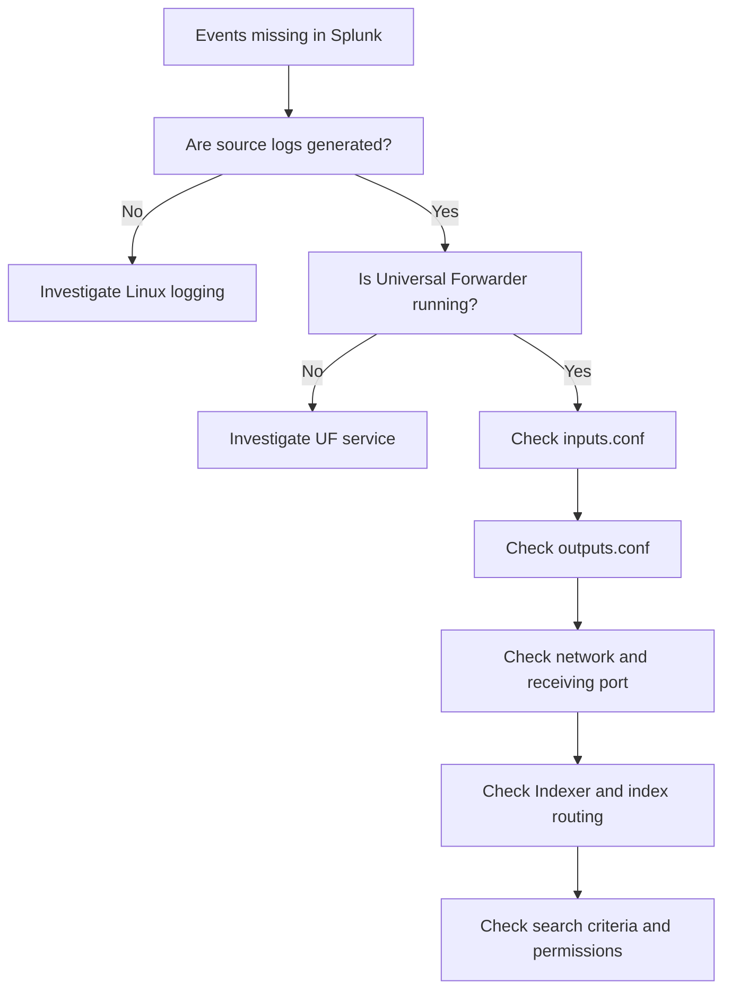

# Part 1 — Splunk Fundamentals 1

# Module 1 — Introduction to Splunk

**Focus:** Splunk fundamentals, SIEM architecture, logs and events, Forwarders, Indexers, data ingestion, Splunk Web navigation and troubleshooting.

---

# Learning Objectives

By completing this module, you should be able to:

1. Explain what Splunk is and why organizations use it.
2. Understand SIEM fundamentals.
3. Understand logs, events and data sources.
4. Explain the basic Splunk architecture.
5. Understand Universal Forwarders and Heavy Forwarders.
6. Understand Indexers, Indexes and Search Heads.
7. Understand Syslog and HTTP Event Collector (HEC).
8. Understand `inputs.conf` and `outputs.conf`.
9. Understand common Splunk communication ports.
10. Navigate Splunk Enterprise Web UI.
11. Differentiate infrastructure monitoring from security monitoring.
12. Understand how Linux authentication logs reach Splunk.
13. Troubleshoot missing Linux logs.
14. Connect previous infrastructure monitoring experience with SOC responsibilities.

---

# 1. What is Splunk?

## 1.1 Definition

Splunk is a platform used to collect, process, index, search, monitor and visualize machine-generated data.

Machine-generated data can come from:

- Linux servers
- Windows servers
- Firewalls
- VPN devices
- Wireless Access Points (WAPs)
- Satellite modems
- Applications
- Network devices
- Security tools
- Cloud platforms

Organizations use Splunk to centralize and analyze information generated by different systems.

## 1.2 Why Do Organizations Use Splunk?

Imagine an organization has:

- 500 Windows computers.
- 100 Linux servers.
- 20 firewalls.
- 10 VPN devices.
- Multiple applications.
- Network infrastructure.
- Security monitoring tools.

Every system generates information about its activities.

Examples:

- A user logs in.
- A user enters an incorrect password.
- A Linux service restarts.
- A firewall blocks a connection.
- A WAP loses connectivity.
- An application generates an error.
- A user accesses a restricted file.

Without centralized monitoring, analysts may need to access individual systems and examine logs separately.

Splunk allows analysts to search and investigate collected information through a centralized platform.

## 1.3 Example Related to My Previous Experience

In an aviation and maritime connectivity environment, the infrastructure includes:

1. Linux application servers.
2. Satellite modems.
3. Cabin Wi-Fi.
4. IPTV.
5. Wireless Access Points.
6. Firewalls and network infrastructure.

These systems generate operational telemetry and security-related events.

Splunk can collect this information and help analysts investigate:

- Service interruptions.
- Authentication failures.
- Unauthorized access attempts.
- Suspicious network connections.
- Configuration changes.
- Application errors.
- Security alerts.
- Device behaviour.

## 1.4 Why Is Splunk Useful in a SOC?

A Security Operations Center uses security monitoring solutions to identify, investigate and respond to potential security threats.

Splunk can help SOC analysts:

1. Investigate failed and successful authentication.
2. Identify suspicious source IP addresses.
3. Investigate brute-force attempts.
4. Review firewall and VPN events.
5. Investigate malware alerts.
6. Identify suspicious user activities.
7. Build reports and dashboards.
8. Configure security alerts.
9. Correlate events from multiple sources.
10. Support incident investigations.

**Important distinction:**

Splunk Enterprise is a data platform. Complete SIEM capabilities require appropriate security data sources, detection logic, alerting, security applications and incident response processes.

Splunk Enterprise Security is a separate security application that provides additional SIEM-oriented capabilities.

## 1.5 Interview Answer

**Question: What is Splunk, and why is it used in a SOC?**

Answer:

Splunk is a platform used to collect, process, index, search, monitor and visualize machine-generated data. In a SOC environment, it helps analysts centralize security logs from different sources, investigate suspicious activities, identify potential threats and support incident response.

---

# 2. What Is SIEM?

## 2.1 Definition

SIEM stands for **Security Information and Event Management**.

A SIEM solution collects and analyzes security-related information and events from multiple sources to help organizations:

- Monitor security activities.
- Detect potential threats.
- Investigate suspicious events.
- Correlate related activities.
- Support incident response.

## 2.2 Understand SIEM in Simple English

Imagine an organization has:

- Windows endpoints.
- Linux servers.
- Firewalls.
- VPN devices.
- Email security gateways.
- Endpoint Detection and Response (EDR) solutions.

Each system generates security-related events.

A SIEM solution helps centralize this information so that security analysts can investigate suspicious activities.

## 2.3 Splunk vs SIEM

| SIEM                                  | Splunk                                                |
| ------------------------------------- | ----------------------------------------------------- |
| Security monitoring solution/category | Data platform                                         |
| Collects security information         | Collects and analyzes different types of machine data |
| Supports threat detection             | Supports searches, detections and alerts              |
| Supports incident investigation       | Provides searchable events and investigation tools    |

**Remember:** Installing Splunk alone does not automatically create an effective SIEM environment. The organization must onboard appropriate security data and configure detection, alerting and investigation processes.

---

# 3. Logs, Events and Data Sources

## 3.1 What Is a Log?

A log is a record of an activity generated by an operating system, application, server, network device or another system.

Think of a log as a diary maintained by a computer.

Examples:

- User logged in.
- User entered an incorrect password.
- Service restarted.
- Firewall blocked a connection.
- Device configuration changed.
- Application generated an error.
- File was accessed.

## 3.2 What Is an Event?

An event is an individual occurrence represented as a record in Splunk.

During data ingestion, Splunk processes incoming data and breaks it into searchable events according to the data format and configuration.

A log record can itself become one event in Splunk.

A log file can contain many records and therefore many events.

## 3.3 Linux Authentication Example

Example log:

```text
Nov 18 10:15:25 linux-app-01 sshd[2251]: Failed password for invalid user admin from 203.0.113.45 port 51422 ssh2
```

Understand the information:

| Information | Example value   | Meaning                          |
| ----------- | --------------- | -------------------------------- |
| Timestamp   | Nov 18 10:15:25 | When the event was recorded      |
| Host        | linux-app-01    | System that generated the record |
| Process     | sshd            | SSH service                      |
| Activity    | Failed password | Authentication failure           |
| Username    | admin           | Attempted account                |
| Source IP   | 203.0.113.45    | Origin of the attempt            |
| Source port | 51422           | Client-side port                 |

Note: `203.0.113.45` belongs to an IP address range reserved for documentation. It is not a real malicious indicator.

## 3.4 SOC Investigation

One failed login does not automatically indicate a brute-force attack.

Investigate:

- Number of failed attempts.
- Source IP address.
- Targeted username.
- Whether the account exists.
- Whether a successful login followed.
- Whether other servers were targeted.
- Whether related security alerts exist.

## 3.5 Important Terminology

| Term        | Meaning                                               |
| ----------- | ----------------------------------------------------- |
| Log         | Recorded activity or message                          |
| Event       | Individual occurrence represented in the data         |
| Log file    | File containing log records                           |
| Data source | System or application generating data                 |
| Host        | Device associated with an event                       |
| Source      | File, stream or input from which Splunk obtained data |
| Sourcetype  | Splunk classification describing the data format      |
| Index       | Repository containing indexed data                    |

---

# 4. Splunk Architecture

The important components introduced in this module are:

1. Forwarder.
2. Indexer.
3. Index.
4. Search Head.
5. Splunk Web.

## 4.1 Splunk Data Flow Architecture



This is a conceptual architecture, not a verified diagram of a production environment.

## 4.2 Forwarder

### Definition

A Forwarder is a Splunk software component that collects configured data and forwards it to another receiving Splunk component or configured destination.

**Main responsibility: Collect and forward data.**

Example:

A Linux application server generates authentication logs.

A Universal Forwarder monitors the configured authentication log file and sends the data to the Indexer.

## 4.3 Indexer

### Definition

An Indexer receives incoming data, processes it, indexes it and stores it in indexes so that it can be searched later.

**Main responsibility: Receive, process, index and store data.**

## 4.4 Index

### Definition

An Index is a repository in which Splunk stores indexed data.

Example indexes:

| Index        | Possible purpose               |
| ------------ | ------------------------------ |
| linux_auth   | Linux authentication events    |
| linux_syslog | Linux system messages          |
| windows      | Windows events                 |
| firewall     | Firewall events                |
| vpn          | VPN events                     |
| security     | Selected security-related data |

These are illustrative index names. Actual indexes are configured by the organization.

### Indexer vs Index

| Indexer                 | Index                            |
| ----------------------- | -------------------------------- |
| Splunk component        | Data repository                  |
| Processes incoming data | Stores indexed data              |
| Performs indexing       | Holds searchable indexed records |

**Interview answer:**

An Indexer is responsible for processing, indexing and storing incoming data, whereas an Index is the repository where Splunk stores indexed data.

## 4.5 Search Head

### Definition

A Search Head provides search management and coordinates searches across relevant Indexers in a distributed deployment.

It enables analysts to:

- Execute searches.
- Investigate events.
- View search results.
- Create reports.
- Build dashboards.
- Configure alerts.
- Analyze security information.

**Interview answer:**

A Search Head coordinates search requests across Indexers and provides the interface through which users investigate and analyze data.

## 4.6 Splunk Web

Splunk Web is the browser-based interface through which users interact with Splunk.

The Search Head is a Splunk component/role. Splunk Web is the interface used to interact with the platform.

They are related but not identical terms.

## 4.7 Single-Instance vs Distributed Deployment

A small Splunk environment can perform several roles on a single Splunk Enterprise instance.

Large enterprise environments often distribute Forwarders, Indexers and Search Heads across multiple machines for:

- Scalability.
- Workload separation.
- Performance.
- Availability.

---

# 5. Forwarders

## 5.1 Universal Forwarder (UF)

### Definition

A Universal Forwarder is a lightweight Splunk component primarily used to collect configured data and forward it to a receiving Splunk component.

### Characteristics

- Lightweight.
- Low resource consumption compared with a full Splunk Enterprise instance.
- Commonly installed on Windows and Linux endpoints.
- Collects configured log files and other supported inputs.
- Forwards data to configured receivers.
- Does not provide the full indexing and search functionality of Splunk Enterprise.

### Example Related to My Experience

An organization has 100 Linux application servers.

The SOC team wants to collect:

- Authentication logs.
- System logs.
- Application logs.
- Security-related logs.

Universal Forwarders can be installed on those servers and configured to collect the required information.

## 5.2 Heavy Forwarder (HF)

### Definition

A Heavy Forwarder is a full Splunk Enterprise instance configured to forward data.

It supports additional capabilities such as:

- Parsing.
- Filtering.
- Routing.
- Additional data processing.

### Example

An organization receives logs from multiple network devices.

Before forwarding the information to final Indexers, it needs to apply routing or processing rules.

A Heavy Forwarder can perform these operations.

## 5.3 Universal Forwarder vs Heavy Forwarder

| Feature                         | Universal Forwarder     | Heavy Forwarder                   |
| ------------------------------- | ----------------------- | --------------------------------- |
| Resource consumption            | Low                     | Higher                            |
| Full Splunk Enterprise instance | No                      | Yes                               |
| Data collection                 | Yes                     | Yes                               |
| Data forwarding                 | Yes                     | Yes                               |
| Advanced processing             | Limited                 | Yes                               |
| Filtering/routing capabilities  | Limited                 | Yes                               |
| Typical use                     | Endpoint log collection | Additional processing and routing |

Avoid saying that a Universal Forwarder performs absolutely no processing.

The key distinction is that UF is optimized for lightweight collection and forwarding, while HF offers additional processing and routing capabilities.

## 5.4 Light Forwarder

Light Forwarder is a legacy type deprecated in Splunk Enterprise 6.0.

Universal Forwarder replaced it for most lightweight forwarding purposes.

## 5.5 Intermediate Forwarder

An Intermediate Forwarder is a role in a forwarding architecture.

Example:

```text
Linux Server
     |
Universal Forwarder
     |
Intermediate Heavy Forwarder
     |
Indexer
```

It is not a separate fourth primary forwarder software type.

---

# 6. How Data Is Collected from Different Sources

Not every device needs a Universal Forwarder.

The collection method depends on what the source device or application supports.

## 6.1 Universal Forwarder

Commonly used for:

- Linux servers.
- Windows servers.
- Application log files.
- Other supported endpoint inputs.

Example:

```text
Linux Log File
      |
Universal Forwarder
      |
Splunk Indexer
      |
Index
```

## 6.2 Syslog

### Definition

Syslog is a standard logging mechanism/protocol used by systems and network devices to send log messages to a receiver.

It is not a Splunk Forwarder.

### Common transport conventions

| Transport | Port | Purpose                      |
| --------- | ---: | ---------------------------- |
| UDP       |  514 | Traditional Syslog transport |
| TCP       |  514 | Syslog over TCP              |
| TCP       | 6514 | Common Syslog over TLS       |

The actual port and transport must match the device and receiver configuration.

### Example

A firewall generates:

```text
Nov 18 10:30:15 firewall01:
DENY TCP src=10.10.10.25 dst=198.51.100.50
```

The firewall sends this message to a configured Syslog receiver.

A common architecture:

```text
Firewall / WAP / Network Device
              |
              | Syslog
              v
     rsyslog / syslog-ng
              |
              | Writes messages to files
              v
     Universal Forwarder
              |
              v
           Indexer
```

Splunk also provides Splunk Connect for Syslog (SC4S), a container-based Syslog ingestion solution.

SC4S can send supported Syslog data to Splunk through HEC.

**Production note:** Splunk's validated architecture guidance discourages direct TCP/UDP Syslog inputs to Splunk as a general production design. A dedicated Syslog receiver or SC4S is often used.

## 6.3 HTTP Event Collector (HEC)

### Definition

HEC stands for HTTP Event Collector.

It is a Splunk data input mechanism that allows external applications and supported integrations to send events through HTTP or HTTPS using a configured token.

### Example

An IPTV application generates an authentication error.

It can send an event to Splunk through an HEC endpoint.

Example JSON:

```json
{
  "event": {
    "application": "IPTV",
    "user": "user123",
    "action": "authentication_failure"
  }
}
```

### HEC Data Flow

```text
Application
     |
HTTP / HTTPS Request + HEC Token
     |
Splunk HEC Input
     |
Configured Index
```

The default HEC port for Splunk Enterprise is commonly TCP 8088, but it can be changed.

HEC is not a Universal Forwarder.

A device must support HEC or use an intermediary integration.

## 6.4 API and Vendor Integrations

Some devices expose information through APIs, SNMP or vendor monitoring platforms.

### Satellite modem examples

- Signal strength.
- Link status.
- Hardware alarms.
- Configuration information.

### Wireless management platform examples

- Client associations.
- Authentication failures.
- Device configuration changes.

## 6.5 Recommended Starting Collection Methods

| Data source      | Possible collection method                          |
| ---------------- | --------------------------------------------------- |
| Linux server     | Universal Forwarder                                 |
| Windows server   | Universal Forwarder                                 |
| Firewall         | Syslog receiver                                     |
| WAP              | Syslog / Controller integration / API               |
| Satellite modem  | Syslog / API / SNMP                                 |
| IPTV application | Universal Forwarder / HEC / Application integration |

The final choice depends on actual device capabilities and architecture.

---

# 7. Important Configuration Files

## 7.1 inputs.conf

### Definition

`inputs.conf` defines what data Splunk collects.

Example:

An Ubuntu Linux system contains:

```text
/var/log/auth.log
/var/log/syslog
```

We want to collect both files.

### Example configuration

```ini
[monitor:///var/log/auth.log]
disabled = 0
index = linux_auth
sourcetype = linux_secure

[monitor:///var/log/syslog]
disabled = 0
index = linux_syslog
sourcetype = syslog
```

### Explanation

| Configuration | Meaning                         |
| ------------- | ------------------------------- |
| monitor://    | Monitor the specified file/path |
| disabled = 0  | Enable the input                |
| index         | Destination index               |
| sourcetype    | Data classification             |

Note: Actual log paths depend on the Linux distribution and logging configuration. Ensure that the Universal Forwarder has permission to read the files.

**Remember: inputs.conf = What data should I collect?**

## 7.2 outputs.conf

### Definition

`outputs.conf` controls where a Forwarder sends collected data.

### Example configuration

```ini
[tcpout]
defaultGroup = primary_indexer

[tcpout:primary_indexer]
server = splunk-indexer.example.local:9997
```

### Explanation

| Configuration   | Meaning                     |
| --------------- | --------------------------- |
| tcpout          | Forward data using TCP      |
| defaultGroup    | Default destination group   |
| primary_indexer | Name of the receiving group |
| server          | Receiving server            |
| 9997            | Common receiving port       |

The hostname and port must match the actual receiving configuration.

**Remember: outputs.conf = Where should I send the data?**

## 7.3 Indexer Receiving Configuration

The Indexer must be configured to accept incoming forwarded data.

Example:

```ini
[splunktcp://9997]
disabled = 0
```

An administrator can also configure receiving through Splunk Web:

1. Log in to Splunk Enterprise.
2. Open Settings.
3. Select Forwarding and Receiving.
4. Select Configure Receiving.
5. Select New Receiving Port.
6. Configure port 9997 or the approved port.
7. Save.

**Remember: Receiving configuration = Where should the Indexer listen for incoming data?**

## 7.4 Configuration Summary

| Configuration           | Question                                  |
| ----------------------- | ----------------------------------------- |
| inputs.conf             | What should be collected?                 |
| outputs.conf            | Where should data be sent?                |
| Indexer receiving input | Which port should receive forwarded data? |

## 7.5 Configuration Management Precautions

- Avoid editing Splunk default configuration files directly.
- Local custom settings are commonly stored under `$SPLUNK_HOME/etc/system/local/` or managed using deployment apps.
- Configuration precedence matters; multiple configuration files can contribute settings.
- Use `btool ... --debug` to inspect effective configuration and its source files.
- Some changes require a restart or reload depending on the setting.
- Follow the organization's approved change-management process.
- Never publish passwords, HEC tokens, certificates, private keys or internal production details to a public GitHub repository.

---

# 8. Common Splunk and Syslog Ports

These are common defaults and conventions, not mandatory values.

| Port | Protocol | Common purpose                      |
| ---: | -------- | ----------------------------------- |
| 9997 | TCP      | Splunk-to-Splunk receiving          |
| 8088 | TCP      | HEC default on Splunk Enterprise    |
| 8000 | TCP      | Splunk Web default                  |
| 8089 | TCP      | Splunk management interface default |
|  514 | UDP/TCP  | Common Syslog port                  |
| 6514 | TCP      | Common Syslog-over-TLS port         |

**Important:**

- TCP 9997: Common Forwarder-to-Indexer receiving.
- TCP 8088: Common HEC endpoint.

Actual ports depend on configuration.

---

# 9. Splunk Web Navigation

### Definition

Splunk Web is the browser-based interface through which users interact with Splunk.

### Main Interface Components

| Component          | Purpose                              |
| ------------------ | ------------------------------------ |
| Splunk Home        | Main starting page                   |
| Apps               | Access installed Splunk applications |
| Search & Reporting | Search and investigate events        |
| Search Bar         | Enter SPL queries                    |
| Time Range Picker  | Select investigation period          |
| Timeline           | View event volume over time          |
| Fields Sidebar     | View discovered event fields         |
| Events Viewer      | View matching events                 |
| Search History     | Review previously executed searches  |
| Reports            | Manage reports                       |
| Alerts             | Manage alerts                        |
| Dashboards         | View and manage dashboards           |

The exact appearance depends on the Splunk version, application and access permissions.

As a SOC Analyst, Search & Reporting is one of the most important areas.

---

# 10. Operational Monitoring vs Security Monitoring

These areas are related but have different primary objectives.

| Operational Monitoring   | Security Monitoring              |
| ------------------------ | -------------------------------- |
| Device availability      | Unauthorized access attempts     |
| CPU and memory           | Brute-force attacks              |
| Network latency          | Suspicious network connections   |
| Service health           | Privilege escalation             |
| Application errors       | Malware indicators               |
| Satellite signal quality | Unauthorized management access   |
| WAP availability         | Rogue wireless devices           |
| Service restarts         | Suspicious configuration changes |

## 10.1 CIA Triad

CIA stands for:

1. Confidentiality.
2. Integrity.
3. Availability.

| CIA objective   | Example                                   |
| --------------- | ----------------------------------------- |
| Confidentiality | Unauthorized access to sensitive files    |
| Integrity       | Unauthorized system configuration changes |
| Availability    | DDoS or ransomware disrupting services    |

Infrastructure monitoring often focuses strongly on availability and performance.

Security monitoring can address all three CIA objectives.

## 10.2 Can a SOC Analyst Perform Operational and Security Duties?

Yes, depending on the organization's operating model.

Some organizations have separate NOC and SOC teams. Others operate hybrid monitoring teams or closely coordinate both functions.

| Team           | Responsibility                                 |
| -------------- | ---------------------------------------------- |
| NOC            | Network and infrastructure availability        |
| SOC            | Security monitoring and incident investigation |
| Hybrid NOC/SOC | Both operational and security monitoring       |

### WAP Example

A WAP becomes unavailable.

**Operational investigation:**

- Check device connectivity.
- Check power status.
- Check upstream switch.
- Check satellite connectivity.
- Check WAP health.
- Check related infrastructure alerts.

**Security investigation:**

- Check unauthorized administrative logins.
- Check unknown connected devices.
- Check authentication failures.
- Check configuration changes.
- Check suspicious network connections.

If there is evidence of unauthorized access or tampering, escalate the security concern promptly while operational troubleshooting continues.

### Interview Answer

My previous experience includes monitoring 24x7 Splunk SIEM dashboards and telemetry alerts across Linux application servers, satellite modems, cabin Wi-Fi, IPTV and wireless access points.

When an infrastructure alert occurs, I initially investigate its operational impact, device health, connectivity and related logs.

From a security perspective, I would also examine authentication events, unauthorized access attempts, configuration changes and unusual network activities.

I understand that operational failures and security incidents can sometimes be related. Therefore, I would correlate the available events, identify potential root causes and escalate to the appropriate teams based on the findings.

---

# 11. SOC Investigation Examples Related to Edge Infrastructure

These examples connect previous monitoring exposure to security investigation skills. They are illustrative scenarios, not claims about actual production incidents.

## 11.1 Linux Application Server

**Operational scenarios:**

- Service down.
- CPU/memory pressure.
- Application errors.
- Repeated service restarts.

**Security scenarios:**

- SSH brute force.
- Password spraying.
- Unauthorized login.
- Privilege escalation.
- Suspicious process execution.
- Malware alerts.
- Unexpected account changes.

**Investigation:**

- Review authentication timestamps.
- Identify targeted usernames.
- Identify source IPs.
- Check successful logins after failures.
- Review process activity.
- Correlate endpoint security alerts.

## 11.2 Satellite Modem

**Operational scenarios:**

- Link down.
- Signal degradation.
- Antenna issue.
- Power failure.
- Provider or beam issue.

**Security scenarios:**

- Unauthorized management login.
- Suspicious configuration change.
- Unknown management source.
- Unexpected services or connections.

**Investigation:**

- Check modem link status.
- Check signal strength and quality.
- Check antenna and power.
- Review provider outage and maintenance information.
- Review management access logs.
- Check configuration-change records.

## 11.3 Cabin Wi-Fi

**Operational scenarios:**

- Client connectivity problems.
- DHCP issues.
- Upstream network interruption.

**Security scenarios:**

- Authentication abuse.
- Unauthorized clients.
- Suspicious traffic.
- Unusual access patterns.

**Investigation:**

- Review WAP/controller events.
- Review DHCP and DNS records.
- Review RADIUS authentication.
- Check repeated failures.
- Investigate unknown clients.

## 11.4 IPTV Application

**Operational scenarios:**

- Streaming interruption.
- Application errors.
- Backend connectivity issues.

**Security scenarios:**

- Repeated token validation failures.
- Suspicious API requests.
- Unauthorized administrative access.
- Unusual session usage.

**Investigation:**

- Check token expiry.
- Check identity-provider health.
- Identify affected user and client.
- Investigate repeated failures.
- Look for suspicious requests.
- Correlate successful authentication afterwards.

## 11.5 Wireless Access Point

**Operational scenarios:**

- Device unavailable.
- Power failure.
- Upstream switch issue.
- Controller connectivity loss.

**Security scenarios:**

- Unauthorized admin login.
- Configuration tampering.
- Rogue access point.
- Suspicious client association.
- Authentication attacks.

**Investigation:**

- Check WAP health.
- Check upstream connectivity.
- Review administrative authentication.
- Review client associations.
- Check configuration changes.
- Correlate relevant security alerts.

## 11.6 Example Correlation Timeline

| Time     | Event                                    |
| -------- | ---------------------------------------- |
| 09:40 AM | Multiple failed administrative logins    |
| 09:42 AM | Successful administrative login          |
| 09:43 AM | Configuration change                     |
| 09:45 AM | WAP becomes unavailable                  |
| 09:46 AM | Cabin Wi-Fi availability alert generated |

This sequence is suspicious and requires investigation, but the timestamps alone do not prove causation.

An analyst must validate account ownership, change information, device logs, maintenance records and related network evidence.

---

# 12. Troubleshooting: Linux Authentication Logs Missing in Splunk

## Scenario

The Linux server generates authentication logs, but expected events are not visible in Splunk.

## Step 1 — Check the Source Linux Server

Example:

```bash
sudo tail -f /var/log/auth.log
```

Confirm whether new authentication records are being generated.

Note: The log location varies by Linux distribution. Some systems use journald or different log files.

If logs are not generated, investigate Linux logging before troubleshooting Splunk.

## Step 2 — Check Universal Forwarder Status

Example:

```bash
sudo /opt/splunkforwarder/bin/splunk status
```

Check:

- Is the Forwarder installed?
- Is the service running?
- Are there any service errors?

The installation directory may differ.

## Step 3 — Check inputs.conf

```bash
sudo /opt/splunkforwarder/bin/splunk btool inputs list --debug
```

Check:

- Correct file path.
- Input enabled.
- Correct index.
- Correct sourcetype.
- File permissions.

## Step 4 — Check outputs.conf

```bash
sudo /opt/splunkforwarder/bin/splunk btool outputs list --debug
```

Check:

- Correct Indexer address.
- Correct receiving port.
- Correct forwarding group.

## Step 5 — Check Forwarding Destination

```bash
sudo /opt/splunkforwarder/bin/splunk list forward-server
```

Review configured receiving destinations and connection status.

## Step 6 — Check Network Connectivity

Example:

```bash
nc -vz splunk-indexer.example.local 9997
```

Check:

- Network routing.
- Firewall rules.
- Receiving port.
- Indexer reachability.

A successful TCP connection does not prove that events are being indexed; it only validates network reachability.

## Step 7 — Check Indexer

Verify:

- Receiving input enabled.
- Correct receiving port.
- Indexer running.
- Expected index exists.
- Data is being accepted and routed correctly.

## Step 8 — Check Search

Verify:

- Correct index.
- Correct time range.
- Correct host.
- Correct sourcetype.
- Correct event time.
- Search permissions.

## Troubleshooting Flow



### L1 Responsibility

- Confirm the symptom.
- Validate the source and time window.
- Perform permitted basic checks.
- Collect evidence.
- Document findings.
- Escalate to the Splunk or Infrastructure team.

### L2 / Splunk Administrator Responsibility

- Investigate configuration.
- Check forwarding connectivity.
- Validate receiving configuration.
- Investigate parsing and routing.
- Check data ingestion delays.
- Review Splunk internal logs.
- Implement approved configuration changes.

**Important:** Never blindly edit production configurations or restart services. Follow access permissions and change-management procedures.

---

# 13. Practical Labs

## Lab 1 — Explore Splunk Web

**Objective:** Identify the main Splunk interface components.

Tasks:

1. Open an authorized Splunk training environment.
2. Identify Splunk Home.
3. Locate installed applications.
4. Open Search & Reporting.
5. Locate Search Bar.
6. Locate Time Range Picker.
7. Identify Timeline.
8. Identify Fields Sidebar.
9. Locate Events Viewer.
10. Locate Reports, Alerts and Dashboards.

**Expected outcome:** Explain the purpose of the main interface components.

**Status:** Completed.

## Lab 2 — Identify Different Log Types

Study five sample records:

1. Linux authentication failure.
2. Firewall denied connection.
3. WAP authentication failure.
4. Satellite modem link down.
5. IPTV authentication token validation failure.

For each record, identify:

- Source system.
- What happened?
- Operational or security relevance.
- Additional investigation requirements.

**Expected outcome:** Understand the difference between operational telemetry and security-relevant activity.

**Status:** Completed.

## Lab 3 — Draw Architecture Diagrams

Create two separate diagrams.

### Diagram A: Infrastructure Dependency Architecture

Show the relationships between:

- Linux application servers.
- Firewall.
- Satellite modem.
- Cabin Wi-Fi.
- Wireless access points.
- IPTV.

Do not assume all devices connect in a single straight line.

### Diagram B: Splunk Data-Ingestion Architecture

Show:

- Data sources.
- Collection methods.
- Forwarders.
- Syslog receiver.
- API/HEC integration.
- Indexer.
- Index.
- Search Head.
- SOC Analyst.

Suggested tool:

https://app.diagrams.net/

**Status:** Initial diagram reviewed; revision required.

## Optional Hands-on Extension — UF to Indexer

In an isolated training environment:

1. Prepare a Linux VM.
2. Prepare a compatible Splunk Enterprise/Indexer environment.
3. Install Universal Forwarder on Linux.
4. Identify authentication and system log locations.
5. Configure inputs.conf.
6. Enable receiving on the Indexer.
7. Configure outputs.conf.
8. Check connectivity.
9. Verify Forwarder status.
10. Search the expected index in Splunk Web.

Never perform these configuration activities on employer production systems without authorization.

---

# 14. SOC L1 and L2 Interview Questions

## SOC L1 Questions

### Q1. What is Splunk?

Splunk is a platform used to collect, process, index, search, monitor and visualize machine-generated data. In SOC environments, it helps analysts investigate security events and suspicious activities.

### Q2. What is a log?

A log is a record of activities generated by a computer, operating system, server, application or network device.

### Q3. What is an event?

An event is an individual occurrence represented as a record in Splunk. A log record can be processed into an event.

### Q4. What is a Universal Forwarder?

A Universal Forwarder is a lightweight Splunk component used primarily to collect configured data from endpoints and forward it to a receiving Splunk component.

### Q5. What are the different Forwarders?

Universal Forwarder and Heavy Forwarder are the main types to understand for current deployments. Light Forwarder is a deprecated legacy type.

### Q6. What is an Indexer?

An Indexer receives, processes, indexes and stores incoming data.

### Q7. What is an Index?

An Index is a repository in which Splunk stores indexed data.

### Q8. What is a Search Head?

A Search Head coordinates searches across relevant Indexers and presents results to users.

### Q9. Can a firewall send logs without a Universal Forwarder?

Yes. A firewall can send Syslog to a configured receiver or use another supported integration. The receiver or collector can then forward or ingest the events into Splunk.

### Q10. What is the difference between infrastructure and security monitoring?

Infrastructure monitoring focuses on system availability, performance and service health. Security monitoring focuses on suspicious activities, unauthorized access, threats and security policy violations.

## SOC L2 Questions

### Q1. Explain the complete Splunk data flow.

Data is generated by different sources. Forwarders or other collection mechanisms send the data to receiving components. Indexers process and index incoming data and store it in indexes. Search Heads coordinate searches across the relevant Indexers and display results for analysts to investigate.

### Q2. What is the difference between Universal Forwarder and Heavy Forwarder?

A Universal Forwarder is lightweight and primarily collects and forwards configured data. A Heavy Forwarder is a full Splunk Enterprise instance that supports additional processing, filtering and routing capabilities.

### Q3. What is the difference between inputs.conf and outputs.conf?

inputs.conf defines what data Splunk collects. outputs.conf defines where a Forwarder sends collected data and how forwarding is configured.

### Q4. Why must an Indexer enable a receiving port?

The receiving input allows configured Forwarders to connect and send data. The receiving port must match the destination configured in the Forwarder's outputs.conf.

### Q5. What is the difference between Syslog and HEC?

Syslog is a standard logging mechanism/protocol used by systems and network devices to send messages to a receiver. HEC is a Splunk HTTP/HTTPS event input that uses token-based authentication to accept events from applications and supported integrations.

### Q6. Linux logs are visible on the server but not in Splunk. How would you investigate?

I would troubleshoot from source to search. First, I would verify that the source log is being generated. Then I would check the Forwarder service, effective inputs.conf, file permissions, outputs.conf, forwarding status and network connectivity. Next, I would verify Indexer receiving and index routing. Finally, I would validate the time range, host, sourcetype, event timestamp and search permissions.

### Q7. Why might one WAP outage generate several alerts?

A WAP may depend on upstream power, switches, controllers, network and satellite connectivity. One upstream failure can affect multiple dependent services. I would correlate timestamps and dependency evidence to identify the common root cause while checking for suspicious access or configuration changes where appropriate.

### Q8. Can a SOC Analyst handle both operational and security duties?

It depends on the organization's operating model. Some organizations have separate NOC and SOC teams, while others operate hybrid monitoring teams. A SOC Analyst may review operational telemetry when it helps assess impact or investigate a security event, while following role boundaries and escalation procedures.

---

# 15. Quick Revision Sheet

| Item                | Remember                                                            |
| ------------------- | ------------------------------------------------------------------- |
| Splunk              | Collect, process, index, search, monitor and visualize machine data |
| SIEM                | Security Information and Event Management                           |
| Universal Forwarder | Lightweight collection and forwarding                               |
| Heavy Forwarder     | Additional processing and routing                                   |
| Light Forwarder     | Deprecated legacy forwarder                                         |
| Indexer             | Receives, processes, indexes and stores data                        |
| Index               | Repository containing indexed data                                  |
| Search Head         | Coordinates searches and presents results                           |
| Splunk Web          | Browser-based interface                                             |
| inputs.conf         | What data should be collected?                                      |
| outputs.conf        | Where should data be sent?                                          |
| TCP 9997            | Conventional Splunk receiving port                                  |
| HEC                 | HTTP/HTTPS event ingestion into Splunk                              |
| TCP 8088            | Common default HEC port on Splunk Enterprise                        |
| UDP/TCP 514         | Common Syslog transport                                             |
| TCP 6514            | Common Syslog-over-TLS port                                         |

### Complete Data Flow in One Sentence

Data sources generate events → Forwarders or other collection methods gather and transmit data → Indexers process and store indexed data in indexes → Search Heads coordinate searches → SOC Analysts investigate the results.

---

# 16. Official References

Use current product documentation when implementing configuration because defaults and supported designs can vary by Splunk version and deployment type.

1. [Configure the Universal Forwarder using configuration files](https://help.splunk.com/en/splunk-cloud-platform/forward-and-process-data/universal-forwarder-manual/9.3/configure-the-universal-forwarder/configure-the-universal-forwarder-using-configuration-files)

2. [Configure forwarding with outputs.conf](https://help.splunk.com/en/data-management/forward-data/universal-forwarder-manual/9.1/forward-data/configure-forwarding-with-outputs.conf)

3. [Enable an Indexer receiver](https://help.splunk.com/en/splunk-enterprise/forward-and-process-data/forwarding-and-receiving-data/9.1/deploy-heavy-and-light-forwarders/enable-a-receiver)

4. [Troubleshoot the Universal Forwarder](https://help.splunk.com/en/data-management/forward-data/universal-forwarder-manual/9.0/troubleshoot-the-universal-forwarder/troubleshoot-the-universal-forwarder)

5. [Set up and use HTTP Event Collector](https://help.splunk.com/en/splunk-enterprise/get-data-in/collect-http-event-data/set-up-and-use-http-event-collector-in-splunk-web)

6. [Syslog data collection architectures](https://help.splunk.com/en/data-management/splunk-validated-architectures/getting-data-in/forwarding-and-preprocessing/syslog-data-collection)
